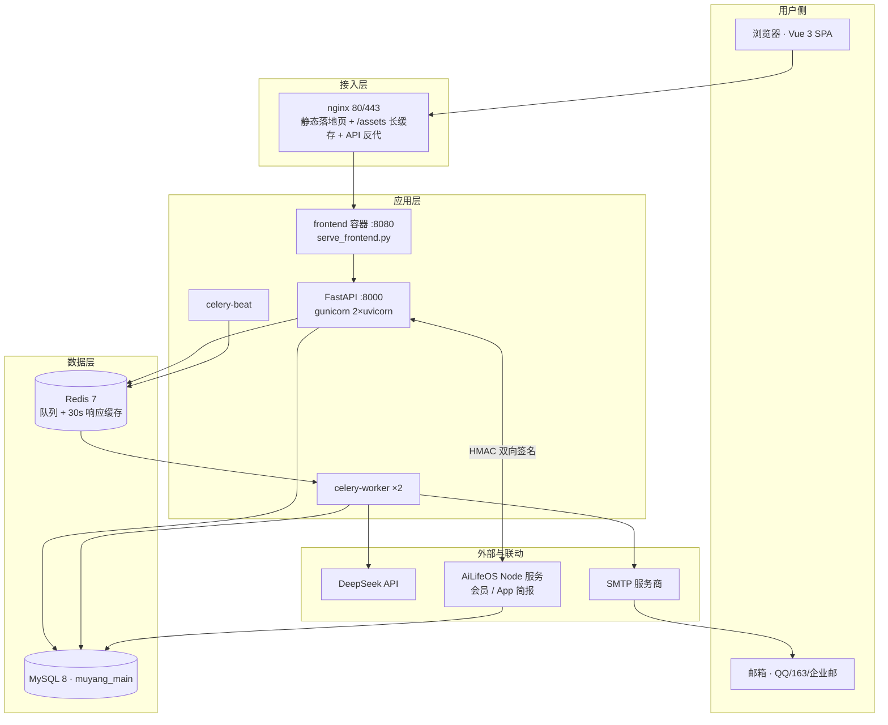
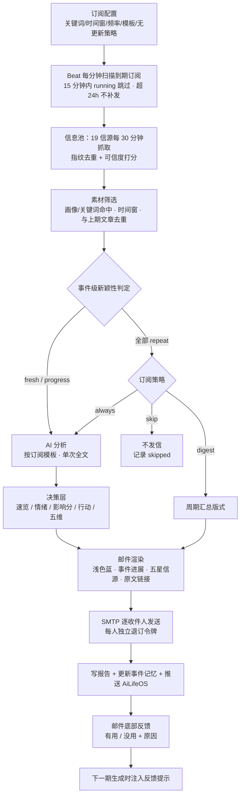
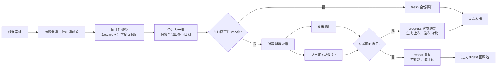
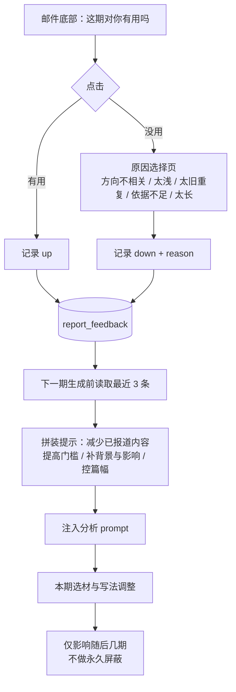
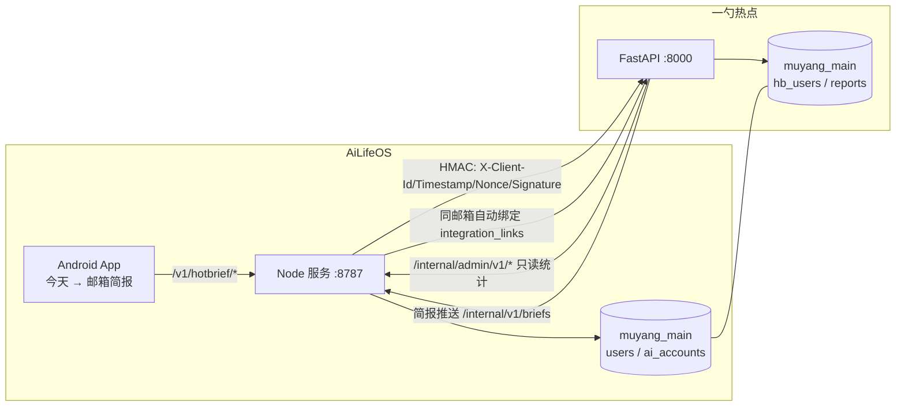
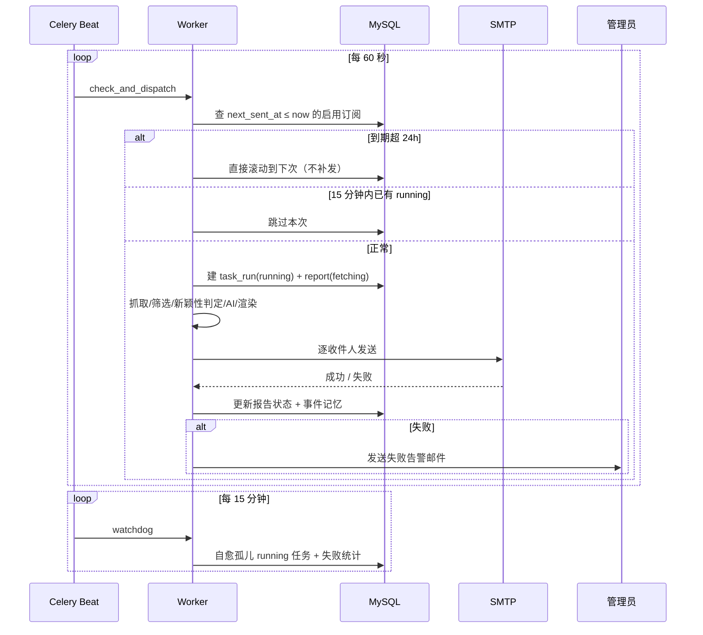

# 一勺热点 · 架构图与流程图（v2 · 2026-11）

> 用法：把下面的 Mermaid 代码块粘贴到 <https://mermaid.live> 或支持 Mermaid 的 Markdown 编辑器，即可导出 PNG/SVG 放进 PPT。
> 共 6 张：① 系统架构 ② 端到端业务链路 ③ 事件级去重与进展判定 ④ 反馈闭环 ⑤ 双产品互通 ⑥ 调度可靠性时序。

---

## 图 1 · 系统架构

---

## 图 2 · 端到端业务链路

---

## 图 3 · 事件级去重与进展判定

---

## 图 4 · 反馈闭环

---

## 图 5 · 双产品互通（AiLifeOS ↔ 一勺热点）

---

## 图 6 · 调度可靠性时序

