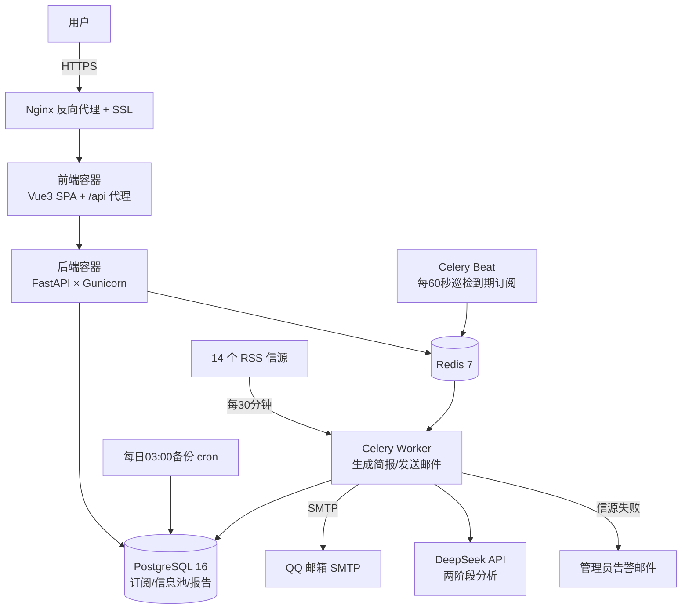
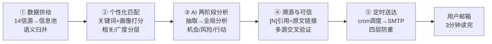
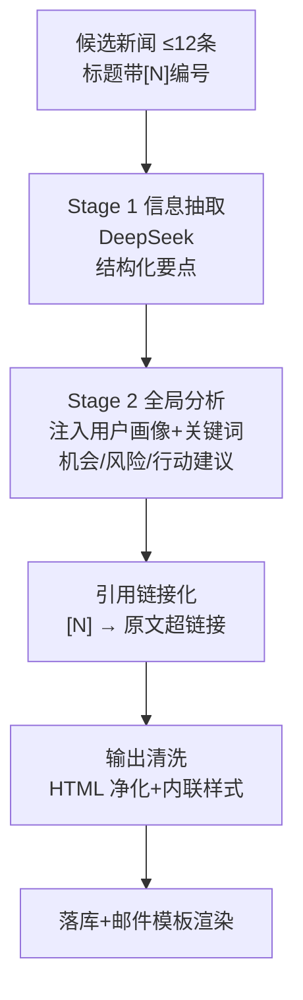
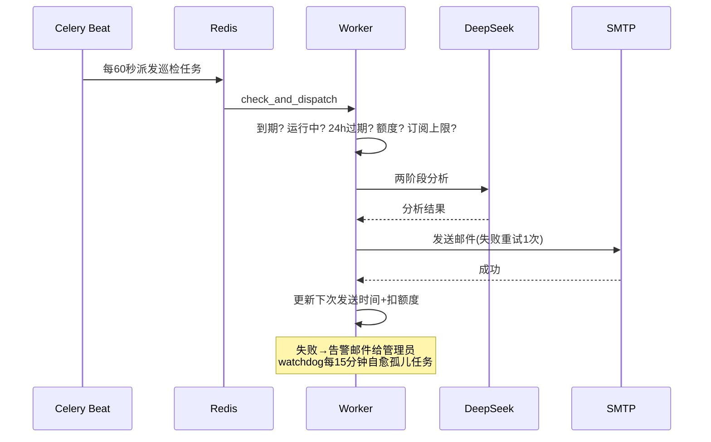
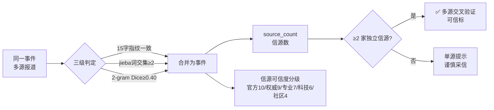

# 一勺热点 架构图与流程图（Mermaid 源码）

> 使用方法：把下列代码块逐个粘贴到 https://mermaid.live ，导出 PNG/SVG 后插入产品说明书与答辩 PPT。
> 每个图都附了文字版，答辩口述可直接用。
> 图中的 PostgreSQL 16 是早期口径。现网数据库是 MySQL 8；与现网一致的图在 `docs/参赛材料/大赛_架构图与流程图.md`。

---

## 图 1：系统架构图

文字版：用户经 HTTPS 访问 Nginx → 前端容器（Vue 3 单页应用 + /api 反代）→ 后端容器（FastAPI）。异步层：Celery Beat 每 60 秒巡检到期订阅，经 Redis 队列派发 Worker；Worker 完成「信息池查询 → AI 分析 → 邮件发送」。信息池由 Worker 每 30 分钟从 14 个 RSS 信源抓取入库。PostgreSQL 承担全部业务数据，每日自动备份。

---

## 图 2：核心业务五步流水线

文字版：新闻先进入信息池并做同事件语义归并；生成简报时按用户关键词与画像打分选材；AI 两阶段把素材翻译成机会/风险/行动建议；每条结论绑定原文链接并做多源交叉验证；最后由调度器按 cron 定时送达，防重机制保证不丢不重。

---

## 图 3：AI 两阶段分析流水线

文字版：AI 分两步工作——第一步把新闻压缩成带编号的结构化要点（降低第二步负担、保证引用编号稳定）；第二步注入用户画像与订阅关键词，生成定制解读。最后把正文中的 [N] 引用替换为原文超链接，实现"结论即证据"。

---

## 图 4：定时调度与可靠性时序

文字版：调度链路每分钟巡检一次，生成前依次通过防重、运行中、过期窗口、账户额度、订阅预算五道闸门；发送失败自动重试并告警管理员；每 15 分钟看门狗自愈因崩溃中断的任务；容器层还有重启策略与每 5 分钟健康巡检双保险。

---

## 图 5：可信度与交叉验证模型

文字版：同事件识别用三级算法（指纹、分词交集、字符相似度）逐级判定；合并后统计独立信源数，≥2 家打交叉验证标；信源本身按媒体类型分级打分——两项指标一起构成简报的"可信度体系"。

---

*以上五张图 + 产品说明书 + 演示视频 + 在线地址 + 代码仓库，即为完整参赛材料包。*
